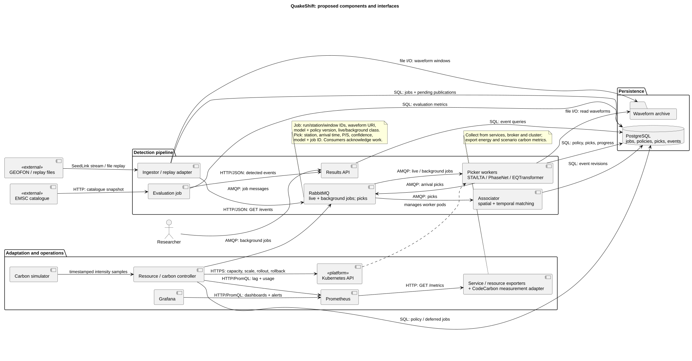

# QuakeShift — architecture

QuakeShift detects earthquakes in live data from European seismometer stations using pretrained models. It changes how much computing it does depending on the carbon intensity of the electricity grid. Everything runs in Docker on a local Kubernetes cluster, on CPUs only. We do not train any models.

**Contents:** [1. Specification](#1-project-specification) · [2. Use cases](#2-architecturally-significant-use-cases) · [3. Architecture](#3-architecture) · [4. Decisions](#4-architecture-decisions)

## 1. Project specification

### Background in one minute

- A **seismometer** records ground shaking, 100 values per second. **GEOFON** (GFZ Potsdam) streams data from about 300 open stations over the **SeedLink** protocol.
- An earthquake sends a fast **P wave** and a slower **S wave**. **Picking** means marking when each wave reaches a station. A *pick* is one such timestamp.
- **STA/LTA** is a classic, almost free trigger: it compares the signal level of the last second with the last 30 seconds.
- **PhaseNet** and **EQTransformer** are pretrained neural networks (SeisBench library) that pick much more accurately. EQTransformer is the larger, slower one.
- If picks from **3 or more stations** arrive within 10 seconds, it is an earthquake. The **EMSC** catalogue is our reference to check our results.

### Features

| ID | Feature |
| --- | --- |
| F1 | Read live station data from GEOFON, or replay recorded data of past earthquakes. |
| F2 | Pick P and S arrivals with STA/LTA, PhaseNet or EQTransformer. |
| F3 | Combine picks from several stations into earthquakes, store them and serve them through an HTTP API. |
| F4 | Switch between three processing profiles (eco, balanced, performance) based on the carbon intensity of the grid. |
| F5 | Back-fill: when the grid is clean, re-check eco periods with EQTransformer to find missed earthquakes. |
| F6 | Evaluate detections against the EMSC catalogue (recall, precision, delay). |
| F7 | Dashboards for system health, model behaviour, energy use and emissions. |

| Profile | When | What runs |
| --- | --- | --- |
| Performance | low carbon intensity | EQTransformer on all stations |
| Balanced | medium | PhaseNet on all stations |
| Eco | high carbon intensity | STA/LTA first; PhaseNet only on triggered windows of core stations |

### Non-functional requirements

Targets are a first draft; we check them on replayed data.

| ID | Quality | Target | How we check it |
| --- | --- | --- | --- |
| N1 | Latency | An earthquake of magnitude ≥ 3 is saved within **60 s** of the first P wave reaching a station, in every profile. | Replay test, timestamps in Prometheus |
| N2 | Throughput | With 10 stations, the Kafka lag of the live pickers does not grow over 10 minutes. | Kafka lag metric |
| N3 | Detection quality | Recall ≥ **90 %** for magnitude ≥ 3 in performance and balanced, ≥ **80 %** in eco. | Evaluator vs EMSC |
| N4 | Energy efficiency | Eco uses at least **50 % less** energy per station-hour than performance. | CodeCarbon |
| N5 | Fault tolerance | If a picker pod crashes, no waveform window is lost and processing restarts within 1 minute. | Kill a pod during replay |
| N6 | Scalability | More stations only need more Kafka partitions and picker pods, no code changes. | Replay with 5 and 20 stations |
| N7 | Reproducibility | The same replay, model versions and configuration give the same earthquakes. | CI replay test |
| N8 | Observability | Every service exposes `/metrics`; profile, lag, latency and energy are visible in Grafana. | Dashboard review |

**Constraints:** no model training or fine-tuning; CPU only (laptops with 16 GB RAM); local Kubernetes (kind or minikube); free and open data only.

## 2. Architecturally significant use cases

| Use case | What happens | Why it shapes the architecture |
| --- | --- | --- |
| **UC1 Detect earthquakes** | Station data flows through ingestor, picker and associator into PostgreSQL. | Needs a streaming pipeline with a buffer between services (Kafka) and drives the latency target N1. |
| **UC2 Switch processing profile** | The carbon controller picks a profile and swaps the picker Deployments. | Needs a controller with Kubernetes access and a handover without data loss (shared Kafka consumer group). |
| **UC3 Back-fill eco periods** | When the grid is clean, a job re-reads eco periods with EQTransformer. | Needs data to stay available after it is processed (Kafka retention) and duplicate-safe writes. |
| **UC4 Evaluate against EMSC** | The evaluator compares our earthquakes with the EMSC catalogue. | Needs repeatable replays and quality metrics for each profile (N3, N7). |
| UC5 Browse earthquakes and dashboards | The user reads earthquakes from the API and watches Grafana. | Needs a results store and monitoring, but adds no new structure. |

## 3. Architecture

### Components

| Component | Responsibility |
| --- | --- |
| **Ingestor** | Reads GEOFON or replay files, cuts 30 s windows per station, writes them to Kafka. |
| **Kafka** | Topic `waveforms` (kept 7 days) and topic `picks`. Buffers data between services and keeps it for back-fill. |
| **Live picker** | Three Deployments, one per profile, in the same Kafka consumer group. Only one runs at a time. |
| **Back-fill job** | Kubernetes Job that re-reads an eco period with EQTransformer and writes extra picks. |
| **Associator** | Groups picks: 3 or more stations within 10 s = earthquake. Saves it to PostgreSQL with a unique key, so repeats cannot create duplicates. |
| **PostgreSQL** | Stores earthquakes and the history of profile changes. |
| **Results API** | FastAPI service: `GET /events`. |
| **Carbon signal** | Serves the simulated carbon intensity from a scenario file (`GET /intensity`). |
| **Carbon controller** | Every 30 s reads the carbon signal and the Kafka lag, chooses a profile, scales the Deployments and starts back-fill jobs. If the lag keeps growing, it steps up one profile even when the grid is dirty. |
| **Evaluator** | Compares our earthquakes (via the API) with EMSC and exports recall, precision and delay as metrics. |
| **Prometheus / Grafana** | Collect `/metrics` from all services and show dashboards and alerts. |

### Behaviour

**Live detection (UC1)**

**Carbon-aware profile switch (UC2)**

**Green back-fill (UC3)**

### Main classes

### CI/CD and monitoring

- **Every pull request (GitHub-hosted runner):** lint and unit tests, then a short replay test on a kind cluster created inside the job, then build the images.
- **Merge to `main`:** push images to GitHub Container Registry. A **self-hosted runner** on the machine that runs our cluster applies the Kubernetes manifests and runs a smoke test. Only `main` can use this runner.
- **Monitoring:** Prometheus scrapes latency, Kafka lag, active profile, CPU, memory, energy and evaluation scores. Grafana alerts when the lag keeps growing or a station stops sending data.

### Carbon metrics

CodeCarbon runs inside every picker and the back-fill job and estimates their energy use (kWh). We multiply this by the carbon intensity of the scenario (gCO₂/kWh) to get emissions. We report energy and gCO₂e **per station-hour** and **per detected earthquake**, including idle time and back-fill. Inside containers CodeCarbon can only estimate energy, so we compare profiles with each other rather than claim exact values.

## 4. Architecture decisions

Each decision is a short record with context, alternatives, consequences and sustainability impact.

| ADR | Decision |
| --- | --- |
| [ADR-001](docs/adr/001-kafka-message-broker.md) | Kafka as the message broker |
| [ADR-002](docs/adr/002-postgresql-results-store.md) | PostgreSQL for results only |
| [ADR-003](docs/adr/003-three-processing-profiles.md) | Three processing profiles from pretrained models |
| [ADR-004](docs/adr/004-profile-switch-by-scaling.md) | Switch profiles by scaling Deployments |
| [ADR-005](docs/adr/005-carbon-controller.md) | Own carbon controller with a simulated signal |
| [ADR-006](docs/adr/006-green-backfill.md) | Green back-fill by re-reading Kafka |
| [ADR-007](docs/adr/007-local-kubernetes-cpu.md) | Containers on local Kubernetes, CPU only |
| [ADR-008](docs/adr/008-measurement-and-monitoring.md) | CodeCarbon with Prometheus and Grafana |
| [ADR-009](docs/adr/009-ci-cd.md) | GitHub Actions with a self-hosted deploy runner |

[How to edit the diagrams](docs/architecture/README.md) · [Local vs server deployment](DEPLOYMENT_COMPARISON.md) · [Project checklist](CHECKLIST.md)
