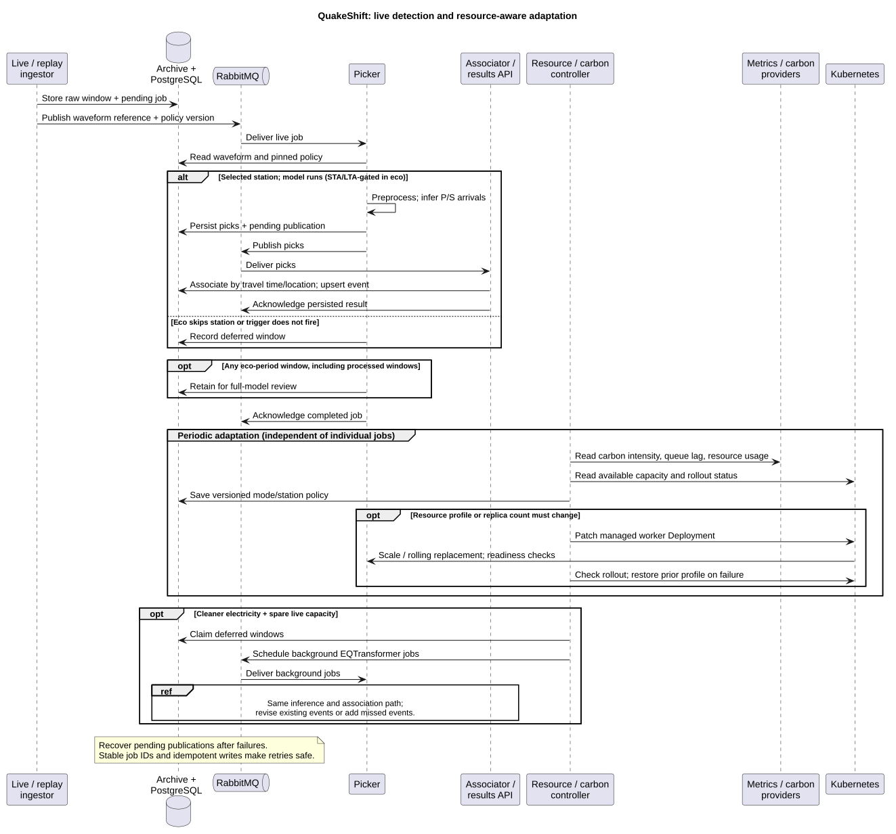

# QuakeShift — architecture overview

**Summary (proposal).** Detect earthquakes from European seismic recordings using pretrained models, while adapting computation to electricity's carbon intensity and available hardware. Run a two-person prototype in Docker on local Kubernetes (kind/minikube); train no model weights.

## Data and detection

- **GEOFON:** GFZ's seismological network and data service. **SeedLink:** the protocol used to stream its live station recordings. Replay archived recordings for repeatable tests.
- **PhaseNet / EQTransformer:** pretrained neural models, available through the **SeisBench** Python library, that identify P (compressional) and S (shear) wave arrival times used to locate earthquakes. EQTransformer also detects earthquake signals.
- **STA/LTA:** the ratio of short-term to long-term averages of signal level; a lightweight trigger for deciding when to run a neural model.
- **EMSC:** European-Mediterranean Seismological Centre; its earthquake catalogue supplies reference events and magnitudes for evaluation.

| Mode | Processing policy |
| --- | --- |
| Performance | EQTransformer on all configured stations |
| Balanced | PhaseNet on all configured stations |
| Eco | Fewer inference stations; STA/LTA triggers PhaseNet; retain all raw recordings |

## Use cases and quality targets

1. **Detect and inspect:** associate arrivals across stations using location and travel times; expose earthquake candidates through an HTTP API.
2. **Adapt and redeploy:** respond to carbon intensity, resource pressure and queue delay by changing mode and worker deployment.
3. **Recover missed events:** reprocess eco-period recordings when cleaner electricity and spare capacity are available; revise existing events without duplicates.
4. **Replay and evaluate:** compare modes against EMSC using identical recordings, including noise-only periods; recover safely from interrupted jobs.

**Targets:** detect each magnitude ≥ 3 reference event within 60 seconds of origin time in the declared test region, in every mode; sustain ingestion without growing live queues. Validate these targets through replay and report misses, precision, recall and latency. Pin inputs, models and configuration for reproducibility.

## Components and architecture decisions

**Ingestor → RabbitMQ → picker workers → associator → event database/API.** RabbitMQ is a message broker: it buffers and delivers work between services. Use separate live/background queues; keep waveform files in persistent storage and jobs, policies, picks and events in PostgreSQL. Persist pending publications, acknowledge completed work and deduplicate retries. These choices support recovery but add operational overhead.

A **resource/carbon controller** reads simulated carbon intensity, Prometheus metrics and Kubernetes capacity. It selects versioned processing policies and predefined CPU/memory/GPU deployment profiles, scales workers, and requests rolling redeployments through the Kubernetes API. Give it permissions only for managed workloads. Use cooldowns, readiness checks and controller-triggered rollback on failed rollouts; preserve live capacity and pause background work first. Redeployment cannot create missing hardware; report degraded service when capacity is insufficient.

## GitHub CI/CD and monitoring

**Proposed GitHub Actions workflow:** pull request → lint/unit tests → replay/retry integration tests → image build. Merge to main → publish a commit-tagged image to GitHub Container Registry → deploy through a trusted self-hosted runner with local-cluster access → readiness/replay smoke test → restore the previous image if validation fails. Run untrusted pull-request jobs separately from deployment credentials.

**Prometheus** collects service/exporter metrics; **Grafana** displays them and alerts on excessive queue age, missing stations, detection delays and failed rollouts. Monitor CPU/RAM/GPU usage, throughput, errors, active mode and deferred-work age.

**Carbon metrics:** export CodeCarbon energy estimates (kWh), carbon intensity (gCO2e/kWh), and calculated emissions (`Σ interval kWh × intensity`). Include idle time and reprocessing; avoid double-counting shared hardware. Report energy/emissions per fixed input station-hour and per unique matched earthquake; label simulated emissions separately from real-grid estimates.

## UML diagrams

Expand to view rendered diagrams; editable PlantUML sources are linked below each image.

Component diagram — components and interfaces

[PlantUML source](docs/architecture/components.puml)

Sequence diagram — detection, adaptation and reprocessing

[PlantUML source](docs/architecture/sequence.puml)

Use-case diagram

[PlantUML source](docs/architecture/use-cases.puml)

[Diagram viewing instructions and technical references](docs/architecture/README.md)

[Architecture choices and alternatives](ARCHITECTURE_COMPARISON.md) · [Project checklist](CHECKLIST.md)
