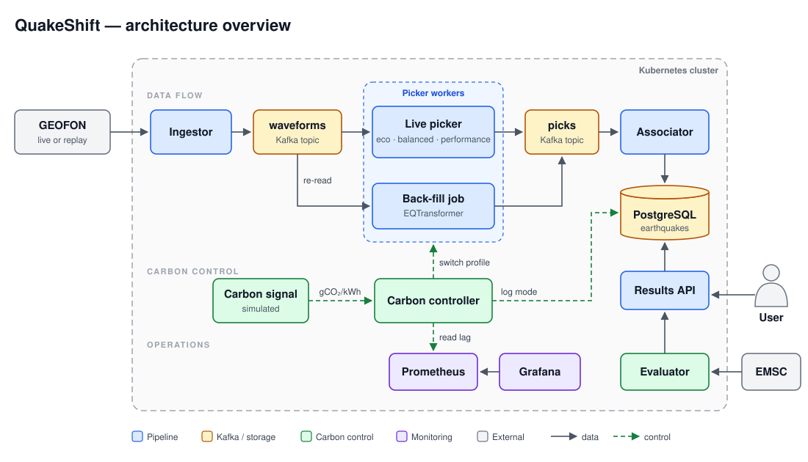
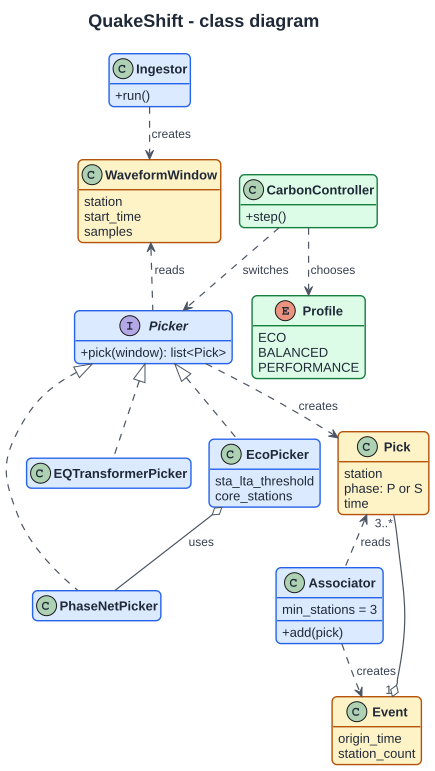
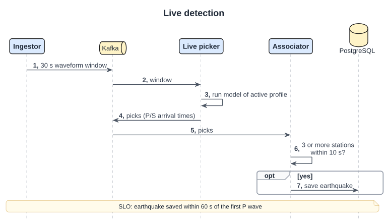
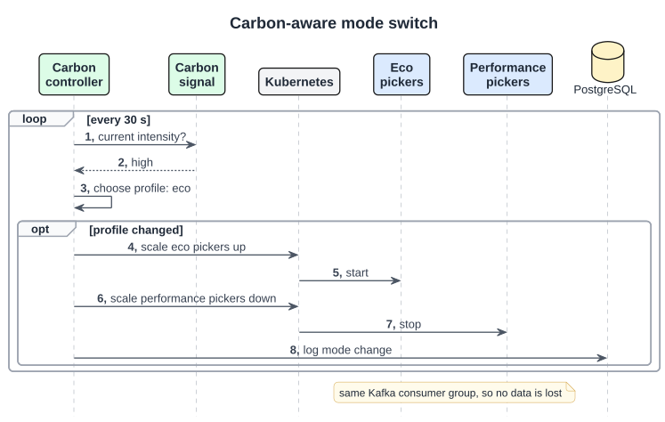
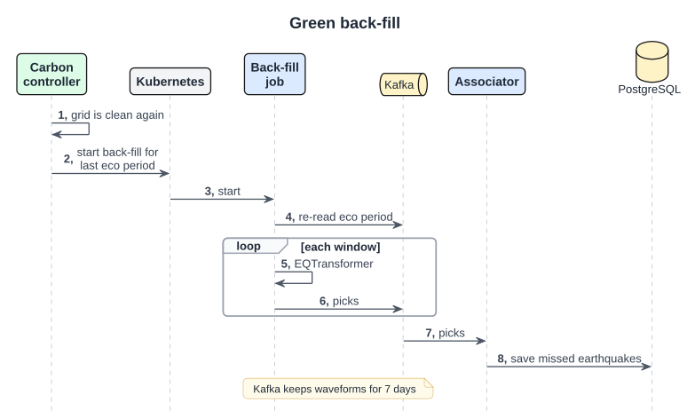
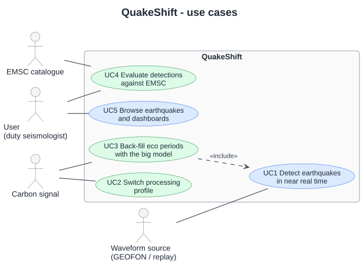

# QuakeShift — architecture overview

QuakeShift detects earthquakes in live data from European seismometer stations using pretrained models. It changes how much computing it does depending on the carbon intensity of the electricity grid. Everything runs in Docker on a local Kubernetes cluster (kind or minikube), on CPUs only. We do not train any models.

## Data and detection

- **GEOFON** (GFZ Potsdam) streams live station data over the **SeedLink** protocol. For tests and the demo we replay recorded data of real earthquakes, so runs are repeatable.
- **PhaseNet** and **EQTransformer** are pretrained neural networks from the **SeisBench** library. They mark when the P wave (fast, first) and the S wave (slower) arrive at a station. This is called *picking*.
- **STA/LTA** compares the signal level of the last second with the last 30 seconds. It is almost free to compute, so in eco mode it decides when the neural network is worth running.
- The **associator** declares an earthquake when picks from at least 3 stations arrive within 10 seconds of each other.
- The **EMSC** catalogue is our reference: we compare our detections with it to measure recall and precision.

| Profile | When | What runs |
| --- | --- | --- |
| Performance | low carbon intensity | EQTransformer on all stations |
| Balanced | medium | PhaseNet on all stations |
| Eco | high carbon intensity | STA/LTA first; PhaseNet only on triggered windows of core stations |

## Use cases and targets

1. **Detect earthquakes** in near real time and show them through an HTTP API and Grafana.
2. **Switch processing profile** when the carbon intensity or the backlog changes.
3. **Back-fill eco periods**: when the grid is clean again, re-check the data from eco periods with EQTransformer to find small earthquakes that were missed.
4. **Evaluate** each profile against EMSC on the same replayed data.

**Targets (SLOs):** an earthquake of magnitude 3 or more is saved within 60 seconds of the first P wave reaching a station, in every profile. The Kafka lag of the live pickers must not keep growing.

## Components

**Ingestor → Kafka `waveforms` → picker → Kafka `picks` → associator → PostgreSQL → results API.**

- **Kafka** moves the data between services and keeps the waveforms for 7 days. Because Kafka keeps messages after they are read, the back-fill job can simply re-read an eco period. We do not need a separate waveform archive.
- **PostgreSQL** stores the results: earthquakes, the history of mode changes, and evaluation scores. Each earthquake has a unique key, so a repeated message cannot create a duplicate.
- **Picker profiles** are three Kubernetes Deployments in the same Kafka consumer group. Only one is scaled up at a time. When the profile changes, Kafka hands the stations over to the new pods, so no window is lost.
- The **carbon controller** reads a simulated carbon signal (a scenario file) and the Kafka lag from Prometheus every 30 seconds. It chooses a profile, scales the Deployments through the Kubernetes API, and starts a back-fill Job when the grid is clean. If the lag keeps growing, it steps up one profile even when the grid is dirty.

## CI/CD and monitoring

- **GitHub Actions:** on every pull request, run linting and unit tests, then a short replay test on a kind cluster inside the job, then build the images. On merge to `main`, push the images to GitHub Container Registry and deploy to the local cluster.
- **Prometheus** scrapes `/metrics` from every service: latency, Kafka lag, active profile, CPU and memory. **Grafana** shows the dashboards and alerts when the lag grows or a station stops sending data.

## Carbon metrics

CodeCarbon runs inside every picker and the back-fill job and estimates their energy use (kWh). We multiply this by the carbon intensity of the scenario (gCO₂/kWh) to get emissions. We report energy and gCO₂e per station-hour and per detected earthquake, including idle time and back-fill. Inside containers CodeCarbon can only estimate energy, so we compare profiles with each other rather than claiming exact numbers.

## UML diagrams

**Class diagram**

**Sequence diagram — live detection**

**Sequence diagram — carbon-aware mode switch**

**Sequence diagram — green back-fill**

**Use-case diagram**

[How to edit the diagrams](docs/architecture/README.md) · [Architecture choices and alternatives](ARCHITECTURE_COMPARISON.md) · [Project checklist](CHECKLIST.md)
